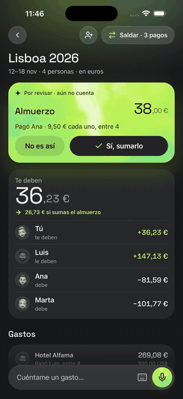
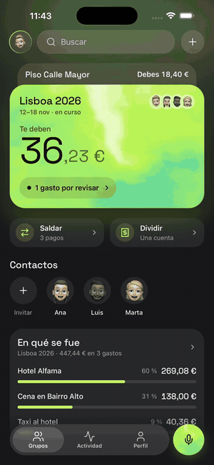
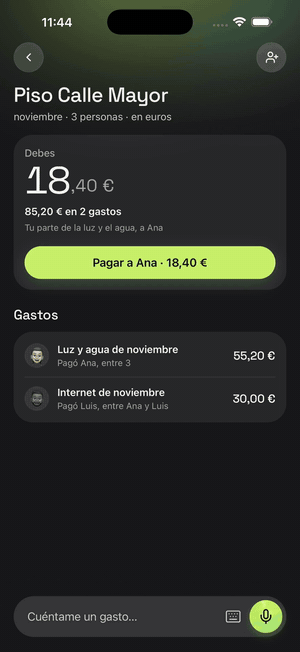
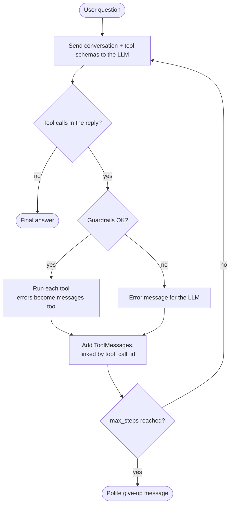

# Zerow

**Split a trip with friends by saying what you paid.** Zerow (zero + owe) is an iPhone app for shared expenses: you say or type *"I paid the taxi, 45 dollars, for Ana and me"*, it proposes an expense card, a person confirms it, and at the end it works out who pays whom until everyone is at zero.

This repository has both halves:

- **The app** ([`app/`](app)): Expo / React Native, designed in Figma first. A working prototype of every screen and flow.
- **The engine** ([`zerow/`](zerow)): a tool-calling AI agent **written from scratch** in Python (no `create_agent`, no `AgentExecutor`), a trip ledger and an API, with 110 tests.

> 🇪🇸 [Resumen en español abajo](#-resumen-en-español) · The project started as *Bill Buddy*, which is still the repository's name.

| Say it, check it, add it | Settle up until everyone is at zero | Pay and keep the receipt |
|---|---|---|
|  |  |  |

Full-length videos: [new expense](docs/video/03-nuevo-gasto.mp4) · [settling up](docs/video/01-saldar-hasta-a-cero.mp4) · [paying](docs/video/02-pagar-a-ana-y-recibo.mp4) · [first run](docs/video/04-primera-vez.mp4).

## The idea

- **The AI is the input method, not the decision-maker.** It turns a sentence into a draft card. Nothing counts until a person confirms it, and it never invents an amount: if you didn't say how much, it asks.
- **One question at a time.** No forms. The screen you open most (the trip) shows what you're owed, the expense waiting for review and the list.
- **Settling is a checklist.** Zerow works out the fewest payments; you tick them off and the trip ends "a cero".

## The app

Built with Expo SDK 58, expo-router, Reanimated and Skia. The interface is in Spanish.

- **Design system "Aurora":** a graphite page with the brand's lime and mint as ambient light, translucent cards, and lime kept for the one action that is yours. Space Grotesk for amounts and titles, SF Pro for everything you read.
- **Motion that follows iOS:** pages push and sheets rise; screens you open many times a day don't perform, only what changes moves.
- **Accessibility:** VoiceOver labels and announcements, text that grows with Dynamic Type, Reduce Motion and Reduce Transparency respected.
- **Three layouts:** iPhone, and the closed and open states of a folding phone.

```bash
cd app
npm install
npx expo start        # then press i for the iOS simulator
```

**What is real and what is not, today.** The app is a working prototype on sample data: every flow can be walked through, but it does not talk to the engine yet. Its "agent" is a small local stand-in ([`interpret.ts`](app/src/data/interpret.ts)) that mirrors the real one, dictation is simulated, and nothing is saved between launches. The data shapes match the API below so the switch is a matter of replacing that layer.

## The engine: what the agent can do

Real output, running locally with Ollama (`qwen3:8b`):

```text
You: Ana had pasta for 18, Luis had steak for 32, and we shared a 24 dollar bottle of wine. Add 15% tip. How much does each pay?
  🔧 split_itemized(tip_percent=15, items=[{"amount": 18, "person": "Ana"}, {"amount": 32, "person": "Luis"}], shared_amount=24)
     → {"per_person": {"Ana": {"own_items": 18.0, "shared_part": 12.0, "tax": 0.0, "tip": 4.5, "pays": 34.5}, ...
Ana pays $34.50 and Luis pays $50.60.

You: Convert 50 euros to Mexican pesos and 50 euros to Colombian pesos
  🔧 convert_currency(amount=50, from_currency="EUR", to_currency="MXN")
  🔧 convert_currency(amount=50, from_currency="EUR", to_currency="COP")
50 euros is equivalent to:
- 1,038.71 Mexican Pesos (MXN)
- 180,937.58 Colombian Pesos (COP)
```

| Tool | What it does |
|---|---|
| `calculate_tip` | Tip and total for a bill |
| `split_evenly` | Equal shares that **always add up to the exact total** (100 / 3 → 33.34 + 33.33 + 33.33) |
| `split_itemized` | Everyone pays what they ordered, plus an equal part of shared items, plus tax and tip **in proportion to what they consumed** |
| `convert_currency` | Today's exchange rate for 160+ currencies (USD, EUR, MXN, COP, ARS, CLP...) |


*Recorded when the project was still called Bill Buddy.*

## The agent loop, from scratch

Frameworks hide the most important part of an agent. [`zerow/agent.py`](zerow/agent.py) writes it out in about 60 lines:



```python
for _ in range(self.max_steps):
    reply = self.model.invoke(self.messages)          # 1. ask the LLM
    self.messages.append(reply)
    if not reply.tool_calls:
        return message_text(reply)                    # 2. no tools -> final answer
    for call in reply.tool_calls:                     # 3. run EVERY requested tool
        result = self.run_tool(call["name"], call["args"])
        self.messages.append(ToolMessage(json.dumps(result), tool_call_id=call["id"]))
                                                      # 4. loop: the LLM reads the results
```

### Guardrails: rules in code, not just in the prompt

The prompt says *"if the user only says 'pesos', ask which country"*. In testing, `qwen3:8b` ignored that and assumed Mexican pesos every time. So the rule is now checked **in code** ([`guardrails.py`](zerow/guardrails.py)) before `convert_currency` runs: an ambiguous peso conversion is blocked, and the model is told to ask. That's what the terminal demo below shows. Guardrails work the same with any model, big or small.

## Trip mode: the backend for a group-trip app

The chat is fun, but the real use case is a trip with friends: lots of small expenses, two currencies, and a messy "who owes whom" at the end. Trip mode is the backend for the app above, where **the agent is the input method**:

```text
"I paid the taxi, 45 dollars, for Ana and me"
        │  POST /trips/1/chat
        ▼
  Trip agent ── propose_expense(...) ──► DRAFT card: Taxi · $45 (≈ 40.36 €) · paid by Laura · Laura, Ana
        │                                             │
        ▼                                             ▼  the person taps ✓
  "Here's the taxi card, please confirm it"     POST /expenses/2/confirm
                                                      │
                                                      ▼
                                     Balances + settle-up: "Ana pays Laura 20.18 EUR"
```

**Design rules:**
- **The AI suggests, people decide.** The agent can only create *drafts*. It has no tool to confirm, edit or delete. Balances only count confirmed expenses, so the AI can never move money on its own.
- **Numbers come from people.** A guardrail blocks any amount or tip the user never said. In testing, *"Paid lunch"* made the model invent "25 EUR + 10% tip". Now it asks *"How much was lunch?"*.
- **Fresh data every time.** Expenses change in the app between messages, so the agent must re-read balances for every question instead of answering from memory (the model did that in testing).
- **USD and EUR.** Each trip has a main currency. An expense in the other currency keeps its original amount, the exchange rate of that day, and the converted amount.
- **Settle-up in at most n−1 transfers.** It uses the greedy "biggest debtor pays biggest creditor" method ([`settle.py`](zerow/settle.py)). The true minimum number of transfers is NP-hard in general. Tested on random trips: every balance always reaches zero.

| Endpoint | What it does |
|---|---|
| `POST /trips` | Create a trip: name, currency (USD/EUR), members |
| `GET /trips/{id}` | Everything a trip screen needs: members, expenses, drafts, balances |
| `POST /trips/{id}/chat` | Talk to the agent → `reply` + new `drafts` + the tool `steps` |
| `POST /trips/{id}/expenses` | Manual entry (the classic form), confirmed right away |
| `POST /expenses/{id}/confirm` · `DELETE /expenses/{id}` | Accept or discard a card |
| `GET /trips/{id}/balances` | Net balance per person and the transfers that settle the trip |

```bash
uvicorn zerow.api:app --reload
# open http://localhost:8000/docs to try every endpoint in the browser
```

Data lives in a local SQLite file (`ZEROW_DB`, default `zerow.db`).

## Getting started

**Requirements:** Python 3.10+ and [Ollama](https://ollama.com) (free, no API key).

```bash
ollama pull qwen3:8b                      # a local model with tool calling (~5 GB)

git clone https://github.com/laulys/bill-buddy.git
cd bill-buddy
python3 -m venv .venv
source .venv/bin/activate                 # Windows: .venv\Scripts\activate
pip install -r requirements.txt
cp .env.example .env                      # works as-is with Ollama
```

```bash
python -m zerow                                           # chat in the terminal
python -m zerow "How much should I tip on \$60 at 20%?"   # one question
python -m zerow --quiet "Split 100 between 3"             # hide the tool calls
uvicorn zerow.api:app --reload                            # trip-mode API on :8000
```

**Other providers:** set `LLM_PROVIDER=openai` and `OPENAI_API_KEY` in `.env` to use OpenAI. For IBM watsonx, run `pip install langchain-ibm` and fill in the `WATSONX_*` values.

## Running the tests

```bash
pip install -r requirements-dev.txt
pytest
```

110 tests, with no API key, no Ollama and no internet needed:
- **Money:** rounding, splits that never lose a cent, proportional tax and tip.
- **Currency:** a fake HTTP API, caching, network errors.
- **Guardrails:** 8 phrasings of "pesos", and amounts or tips the user never said.
- **Agent loop:** a scripted fake LLM covers multi-step chains, parallel calls, unknown tools, invalid arguments, broken JSON, `max_steps`, follow-up memory and rollback after a failure.
- **Trip mode:** settle-up on 25 random trips, balances that always add up to zero, currency conversion, and the full API flow: chat → draft → confirm → balances, plus 400/404/503 errors.

GitHub Actions runs them on every push.

## Improvements over the course lab

This project started as the guided lab *"Build Interactive LLM Agents with Tools"* from IBM Skills Network, which builds a calculator and tip agent by hand. I kept the from-scratch approach and fixed its limits:

| In the lab | In Zerow |
|---|---|
| Runs only `tool_calls[0]` | Runs every tool call in a reply (parallel calls) |
| One round only: can't chain "tip, then split" | Loops until the answer is ready, up to `max_steps` |
| `TipAgent` crashes when the model answers without a tool | Returns the answer directly |
| Unknown tool or bad arguments raise exceptions | Become error messages the LLM can read and fix |
| The class reads global `tools` / `tool_map` | Tools are passed in, so the agent is reusable and testable |
| `int` amounts (no $60.50, no 12.5%) and float math | `Decimal` money, exact cents |
| No memory between questions | Keeps the conversation for follow-ups ("Colombian pesos") |
| Rules only in the prompt | Guardrails enforced in code |

## What I learned

- **What `create_agent` actually does:** a loop of *LLM → tool calls → ToolMessages → LLM*, with `tool_call_id` tying each result to its request.
- **Every failure should become a message.** An agent that crashes on a bad tool call can't recover; one that returns `{"error": ...}` usually fixes itself on the next step.
- **Prompts are suggestions; code is a rule.** Guardrails make critical behavior reliable even with a small local model.
- **Money needs `Decimal`** and a deliberate way to hand out leftover cents.
- **Design the AI's permissions like a product feature.** Drafts plus human confirmation turn a risky "AI handles your money" into a safe "AI fills the form for you".
- **Give the model ready-made facts.** When the balances tool returned raw numbers, the model summarized the transfers wrong. Returning ready-made sentences ("Marta pays Luis 97.27 EUR") fixed it.

## Credits

Based on the IBM Skills Network guided project *Build Interactive LLM Agents with Tools* (author: Joshua Zhou; contributors: Kunal Makwana and Karan Goswami). The code in this repository is my own. Exchange rates by [ExchangeRate-API](https://www.exchangerate-api.com).

---

## 🇪🇸 Resumen en español

**Zerow** (de *zero* + *owe*) es una app para repartir los gastos de un viaje entre amigos. En vez de rellenar formularios, dices o escribes lo que pagaste —*«pagué el taxi, 45 dólares, para Ana y para mí»*— y Zerow propone una tarjeta que una persona confirma. Al final calcula quién paga a quién hasta que todos quedáis a cero.

**Qué hay en este repositorio:**
- **La app** (`app/`): Expo / React Native, diseñada antes en Figma. Es un prototipo funcional con datos de ejemplo: se pueden recorrer todos los flujos, pero aún no está conectada al motor y el dictado es simulado.
- **El motor** (`zerow/`): un **agente programado desde cero**, sin `create_agent`, que llama a herramientas de Python para cada cálculo; el libro de gastos de un viaje y una API.
- **Guardrails**: las reglas importantes se comprueban en código. La IA nunca guarda nada sin tu confirmación ni se inventa un importe.
- Dinero con `Decimal`: las partes siempre suman el total exacto, y el viaje se salda con, como máximo, una transferencia menos que personas.
- 110 tests automatizados con un LLM simulado, e integración continua con GitHub Actions.

**Cómo probarlo:** la app, con los pasos de [The app](#the-app); el motor, con [Getting started](#getting-started) (funciona gratis en tu ordenador con Ollama).

El motor nació del laboratorio guiado de IBM Skills Network, reimplementado y ampliado como proyecto independiente.
